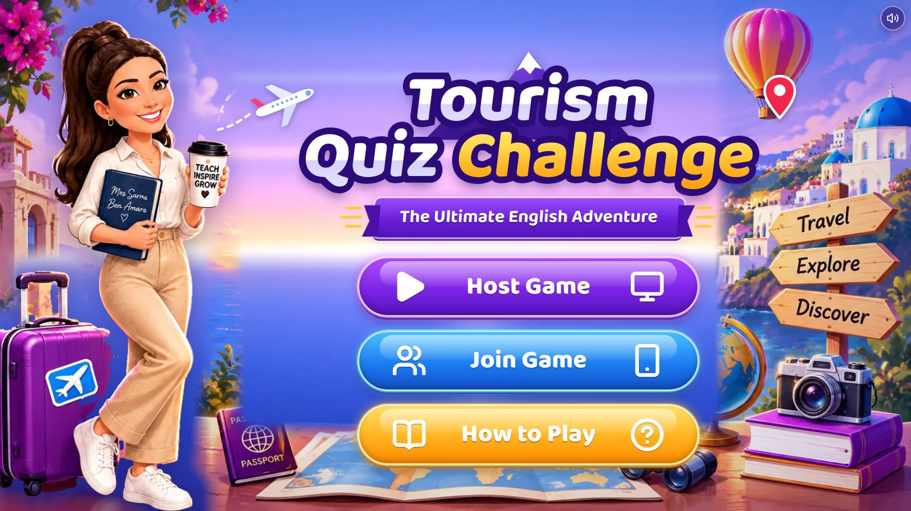
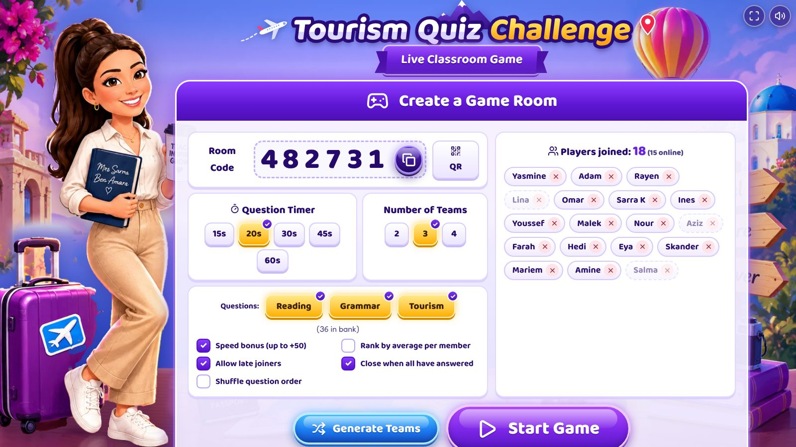
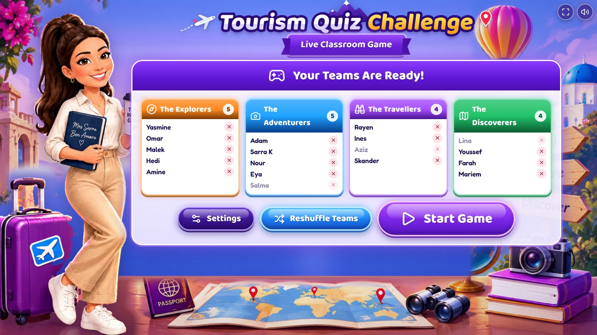
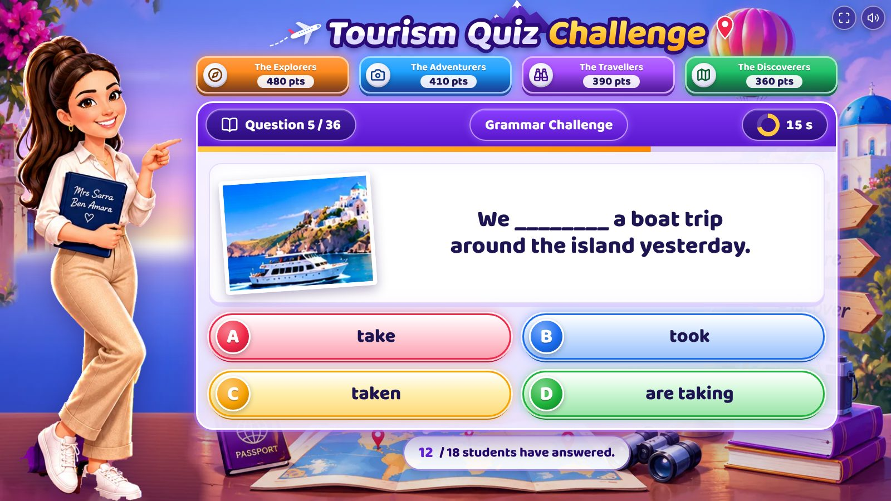
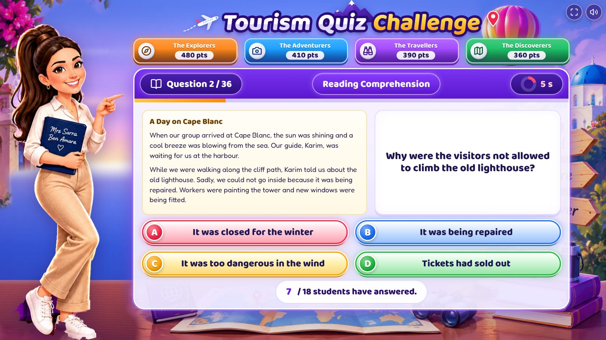
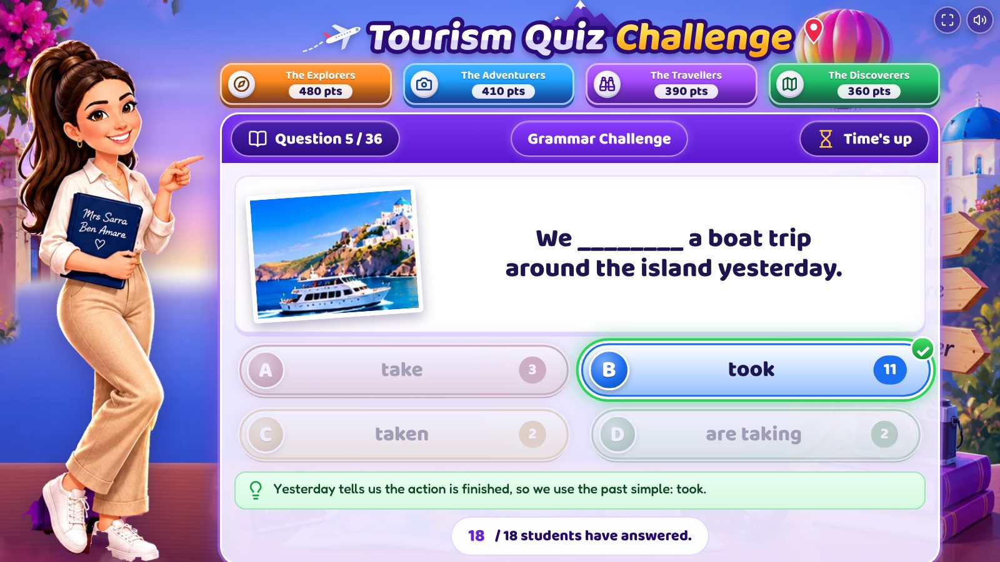
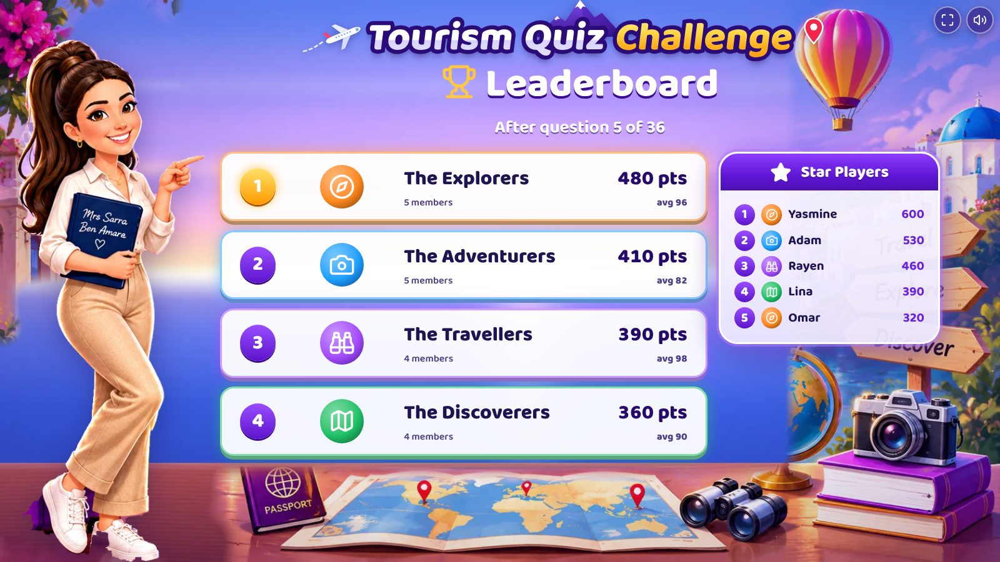
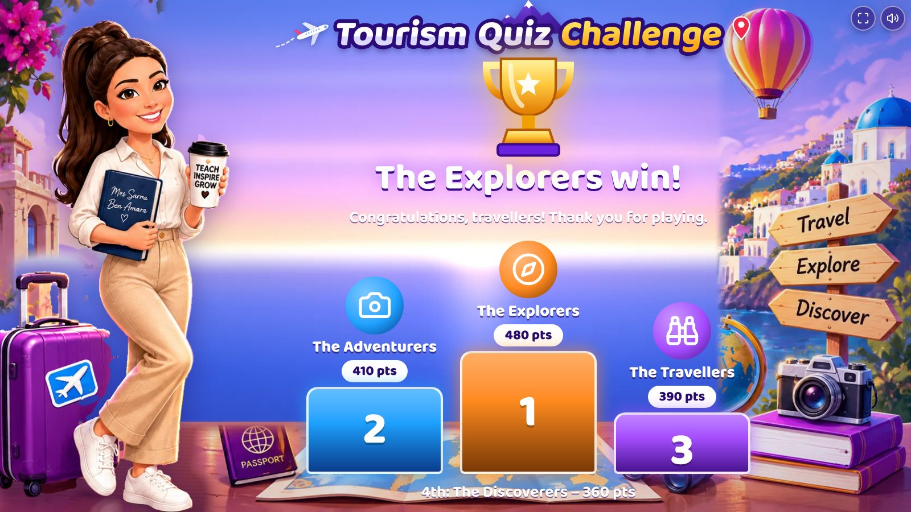
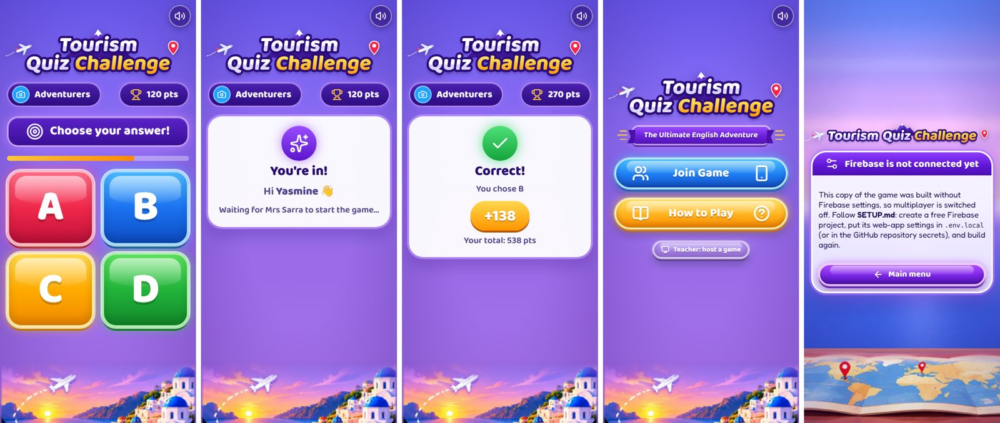

# Tourism Quiz Challenge 🌍✈️

**A live multiplayer classroom quiz for Cambridge Global English Stage 9 – Unit 3: Tourism.**
Created by Mrs Sarra Ben Amara.

The teacher runs the game on the classroom projector. Students join on their phones with a six‑digit code, are put into
random teams, and answer with big **A / B / C / D** buttons. The question and the answer choices are shown **only on the
projector**, so students have to look up and read.

| Projector (teacher) | Phone (student) |
| --- | --- |
| Main menu · room setup · random teams · questions with reading passages · live answer counter · reveal with explanation · animated leaderboard · trophy & confetti finale | Join with code + name · see your team · A/B/C/D answer pad · "Answer submitted!" · correct/incorrect + points · team ranking |

## Built with

- **React + Vite** – the website (hosted free on **GitHub Pages**)
- **Firebase Realtime Database** – real-time sync between projector and phones (free **Spark** plan)
- **Firebase Authentication** – email/password for the teacher, anonymous sign-in for students
- **Firebase Security Rules** – stop students from changing scores, reading answers or controlling the game

No paid server, database or service is needed.

## Documentation

| File | What it covers |
| --- | --- |
| [docs/ARCHITECTURE.md](docs/ARCHITECTURE.md) | How it works, the database layout, the security model, and the limits of the free plans |
| [docs/SETUP.md](docs/SETUP.md) | Step-by-step: Firebase project, teacher account, rules, GitHub Pages deployment |
| [docs/TESTING.md](docs/TESTING.md) | Automated tests and a checklist for testing with several real phones before class |
| [docs/QUESTION-BANK.md](docs/QUESTION-BANK.md) | Adding, editing and importing questions |

## Quick start (on your computer)

```bash
npm install
cp .env.example .env.local      # then paste your Firebase web-app settings (see docs/SETUP.md)
npm run dev                     # opens http://localhost:5173
npm test                        # game-logic unit tests + 82 security-rule scenarios
```

## Project structure

```
database.rules.json          Firebase security rules (the "server-side" protection)
private-question-bank/       The 36-question Unit 3 bank WITH answers – never committed (see .gitignore)
rules-tests/                 Offline security-rules test (82 scenarios)
src/
  firebase/config.js         Firebase setup from environment variables
  lib/gameLogic.js           Pure game logic: teams, scoring, speed bonus, team board, bank validation (+ tests)
  services/                  hostService (teacher), playerService (students), bankService (question bank)
  hooks/useFirebase.js       Live database values, server clock, connection state
  components/                Brand (logo, scenery, persona) and UI pieces (glossy buttons, chips, timer, confetti)
  screens/                   MainMenu, HowToPlay, host/* (dashboard, setup, projector, leaderboard, bank editor), player/*
  assets/img/                Scenery and Mrs Sarra Ben Amara persona, prepared from the reference images
  dev/PreviewGallery.jsx     Design preview of every screen (development builds only: #/__preview)
.github/workflows/deploy.yml Builds and publishes to GitHub Pages on every push to main
```

## Licence & credits

Persona illustration and scenery are taken from the reference artwork supplied by Mrs Sarra Ben Amara. Fonts: Baloo 2 and
Fredoka (SIL Open Font Licence). Icons: Lucide (ISC).

## Screenshots

| | |
| --- | --- |
|  |  |
|  |  |
|  |  |
|  |  |



*(Screenshots use sample names and scores from the design preview.)*
